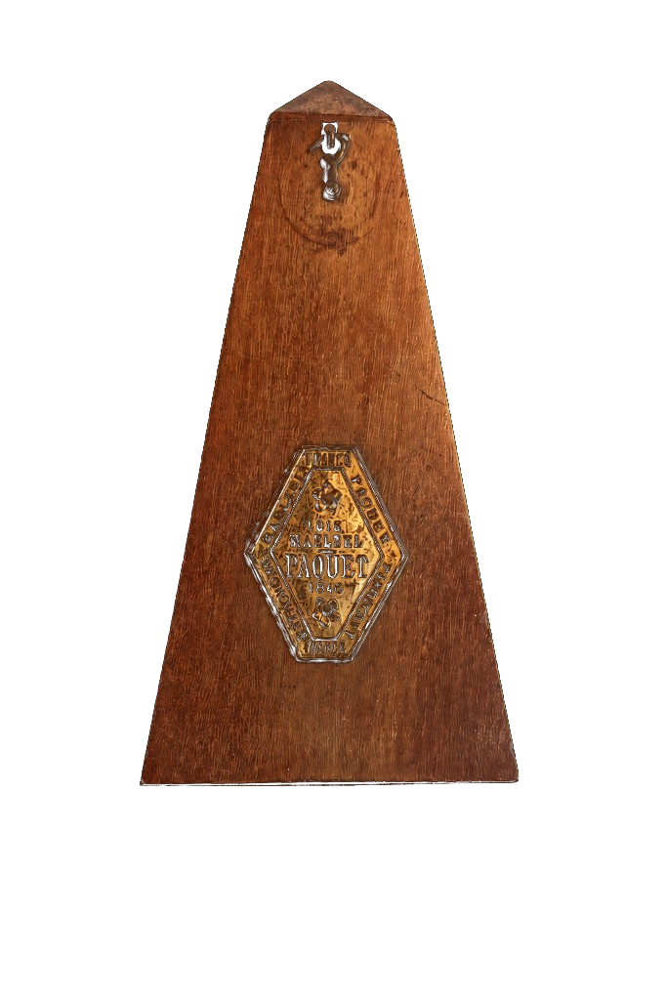

# Musical Time — The Metronome and the Journey of Musical Time

An interactive, scroll-driven listening experience that traces how musical time has been shaped — from the mechanical metronome to algorithmic beat-making. Six movements, one continuous binaural render, one webpage.

[](https://musical-time.pages.dev)
[](https://musical-time.pages.dev)
[](https://vitejs.dev)

**🔊 Listen online: https://musical-time.pages.dev**



---

## What this is

The project is a web companion to a ~20-minute binaural composition for metronome and electronics. Instead of a linear player, the site presents the work as six full-screen "eras" that snap-scroll vertically while a single binaural render plays continuously. Navigation is intentionally quiet: mouse wheel, arrow keys, or the on-screen quarter dial moves you between movements without interrupting the audio.

Each movement pairs a visualisation of time-keeping (swinging metronome arm, quarter-note dial, spatial compass, 28-channel meters) with the corresponding passage of the piece.

## The six movements

The binaural master is a single 19:30 stereo render, split at acoustically detected seams into six parts:

| # | Movement | Start | Duration | REAPER track |
|---|----------|-------|----------|--------------|
| 1 | Introduction | 0:00.0 | 2:01.5 | `Intro` |
| 2 | Baroque | 2:01.5 | 2:00.0 | `Baroque` |
| 3 | Classical | 4:01.5 | 3:36.8 | `Classic` |
| 4 | Romantic | 7:38.3 | 4:16.7 | `Romantic` |
| 5 | Modern & Electronic | 11:55.0 | 5:38.4 | `Electric` |
| 6 | Contemporary & AI | 17:33.4 | 1:56.6 | `AI` |

Total 1170.0 s. Each MP3 is 320 kbps stereo with 0.35 s edge fades so movement changes never click. Segment boundaries are defined by `durationSeconds` in [`src/data/reaperTracks.ts`](src/data/reaperTracks.ts) — edit that file if you re-cut the audio.

> The values in the table are the **measured** seams of the current render, not the original composition sketch (which summed to 1184 s before fade overlaps were applied).

## Playback modes

The site has three playback backends, selectable from the pill in the top-right corner:

| Mode | Where it works | What it does |
|------|----------------|--------------|
| **BINAURAL** | everywhere | Streams the six 320 kbps MP3s in `public/audio/`. Stereo, binaural mix preserved. This is the only mode enabled on the live site. |
| **REAPER** | local only | Routes playback to a local REAPER session through a WebSocket bridge (`ws://127.0.0.1:8080`). |
| **28CH** | local only | Streams 28 discrete channels with live level meters (an installation/showcase mode). |

On the deployed build the app is locked to BINAURAL: 28CH is greyed out, and selecting REAPER shows `REAPER · unavailable online` in the bottom-left status chip plus a hint pointing back to BINAURAL. The lock is driven by `import.meta.env.PROD`, so `npm run dev` keeps all three modes available for testing.

## Tech stack

- **React 19** + **TypeScript 7**, built with **Vite 8**
- CSS only — no UI framework, no animation library (snap scrolling and the metronome arm are hand-rolled)
- **Web Audio API** for channel metering and decoding uploaded WAVs
- **ws** for the optional REAPER bridge
- Deployed as a static bundle on **Cloudflare Pages**

## Getting started

Requires Node.js 18+ and npm.

```bash
git clone https://github.com/locrian666/musical-time.git
cd musical-time
npm install
npm run dev
```

Open http://localhost:5173/. Audio is served from `public/audio`, so playback works with no extra setup.

| Script | Purpose |
|--------|---------|
| `npm run dev` | Vite dev server with HMR |
| `npm run build` | Type-check (`tsc -b`) and build to `dist/` |
| `npm run preview` | Serve the production build locally |
| `npm run bridge` | Start the optional REAPER WebSocket bridge |

## REAPER bridge (optional, local only)

The bridge lets the webpage drive a REAPER project instead of playing MP3s — useful when presenting the piece with the full 28-channel mix.

```bash
# terminal 1
npm run dev

# terminal 2
npm run bridge        # → ws://127.0.0.1:8080
```

When connected, the bottom-left chip reads **REAPER · connected** and the player switches from MP3 streaming to WebSocket transport. Override the endpoint with a `.env` file:

```env
VITE_REAPER_BRIDGE_URL=ws://127.0.0.1:8080
```

### Protocol

**Frontend → bridge**

| type | payload | meaning |
|------|---------|---------|
| `PLAY_SECTION` | `{ section, position?, tracks? }` | Start or resume a movement on the given REAPER track(s) |
| `PAUSE_SECTION` | `{ section }` | Pause and persist progress for that movement |
| `SWITCH_SECTION` | `{ fromSection, toSection, autoPlay?, tracks? }` | Page change: pause + bookmark the previous movement, optionally start the next from its bookmark |
| `STOP` | — | Stop everything (bookmarks the active movement) |
| `GET_STATUS` | — | Current transport state |
| `GET_ALL_PROGRESS` | — | All stored movement bookmarks |

**Bridge → frontend**

| type | payload |
|------|---------|
| `CONNECTION_STATUS` | `{ connected }` |
| `PLAYBACK_STATUS` | `{ section, state, position, duration, tracks? }` |
| `SECTION_PROGRESS` | `{ section, position, duration }` |
| `ALL_PROGRESS` | `{ progress: Record<section, { position, duration }> }` |
| `SECTION_FINISHED` | `{ section }` |
| `ERROR` | `{ message }` |

Movement ids: `introduction`, `baroque`, `classical`, `romantic`, `modern-electronic`, `contemporary-ai`. The REAPER track name for each id lives in `src/data/reaperTracks.ts` and must match your project.

Wheel / arrow-key / dial navigation emits `SWITCH_SECTION` while the bridge is connected, so moving between pages pauses with a bookmark instead of cutting the audio.

## Project structure

```
src/
├─ App.tsx                     full-page snap layout
├─ components/
│  ├─ IntroSection.tsx         opening page + scroll cue
│  ├─ EraSection.tsx           one movement page (text + visual)
│  ├─ AudioPlayer.tsx          transport, progress, movement bookmarks
│  ├─ MetronomeVisual.tsx      swinging metronome arm
│  ├─ QuarterDial.tsx          quarter-note dial + navigation
│  ├─ SpatialCompass.tsx       stereo/binaural field indicator
│  ├─ ChannelMonitor.tsx       28-channel level meters
│  ├─ PlaybackModeSwitch.tsx   BINAURAL / REAPER / 28CH pill
│  └─ BridgeStatus.tsx         bottom-left connection chip
├─ context/
│  ├─ PlaybackModeProvider.tsx mode state + prod lock
│  └─ ReaperBridgeProvider.tsx bridge lifecycle
├─ data/
│  ├─ eras.ts                  essay copy for each movement
│  ├─ sections.ts              scroll order
│  ├─ reaperTracks.ts          movement → REAPER track + duration
│  └─ webAudio.ts              audio urls, mode rules
├─ hooks/                      snap scroll, section navigation, animation
└─ services/
   ├─ webStationPlayer.ts      Web Audio transport
   ├─ reaperBridge.ts          WebSocket client
   ├─ sectionBookmarks.ts      per-movement resume positions
   └─ wavDecode.ts             uploaded WAV decoding (28CH)
bridge/server.js               local mock REAPER bridge
public/audio/                  six movement MP3s (320 kbps)
public/images/metronome/       metronome artwork (closed/open)
```

## Deployment

The live site is a static build on Cloudflare Pages, project `musical-time`, production branch `main`.

```bash
npm run build
npx wrangler pages deploy dist --project-name musical-time --branch main
```

Notes:

- Cloudflare Pages caps individual files at 25 MB; the largest movement MP3 is 12.9 MB, so the whole build (≈49 MB) deploys as-is.
- `node_modules/`, `dist/` and `.DS_Store` are git-ignored; `dist/` is committed nowhere and built at deploy time.
- On macOS, `wrangler login` needs `NO_PROXY=localhost,127.0.0.1` if a system proxy is active, otherwise the OAuth callback is hijacked.

## Editing the content

- **Essay text** — `src/data/eras.ts`. Each entry holds the movement name, subtitle, body copy and its visual mode.
- **Timings** — `src/data/reaperTracks.ts`. `durationSeconds` drives both the player's movement boundary map and the "jump to movement" buttons.
- **Audio** — replace the MP3s in `public/audio/` keeping the filenames (`introduction.mp3`, `baroque.mp3`, `classical.mp3`, `romantic.mp3`, `modern-electronic.mp3`, `contemporary-ai.mp3`).

## Credits

Coursework project for **UCL — ANTH0171PG**, project code **VNWR6**.

Composition, binaural render and web build by the project author. Metronome artwork and audio © the author; please ask before reuse.
